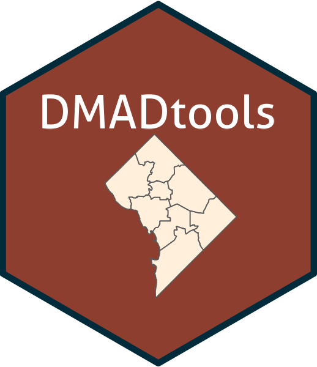

# DMADtools 

<!-- badges: start -->
[](https://github.com/cmainov/DMADtools/actions/workflows/R-CMD-check.yaml)
[](https://www.tidyverse.org/lifecycle/#experimental)
<!-- badges: end -->
  
Functions and data analysis tools.

### Description
___

The functions in this package can be used to facilitate data analysis in a public health context.

* `summary_table`: Generate a "nice" `flextable`, cross-tabulating up to three variables.

* `dc_mapr`: Create a "nice" publication-level map of Washington, D.C. by ward (2012 or 2022 redistricting), ZIP-Code Tabulation Area (ZCTA), Census tract, or block.

* Geocoding tools to query DC’s Master Address Repository (MAR) through the MAR2 API:


 Function | Description | Notes |
|----------|----------|----------|
| `findlocation2`  | DC address geocoding | Sends a POST request with the to the MAR2 API webservice. Returns a `tibble` with data sent back from the API endpoint for the matching address(es). |
| `findDCward`  | Historical ward geography | `findlocation2` returns field `WARD`, which provides the contemporaneous ward geography for an address. Use `findDCward` to get ward geographies for the 2002, 2012, or 2022 ward redistricting cycles. |
| `dc_address_parser`  | An address parser for DC-based addresses | Decomposes, extracts, and builds a clean standardized DC address from an address input string(s). |
| `write_mar2_api_key`, `read_mar2_api_key`  | Functions for securely storing and reading the MAR2 API key into the R environment. | A MAR2 API key can be obtained from OCTO: https://developers.data.dc.gov/ |


### Install
___

Install the development version hosted on this repository (requires the `devtools` package) by specifying the following syntax:

```
# install.packages( "devtools" )
devtools::install_github( "cmainov/DMADtools" )
```

### Bug-reporting and Contributions
___

**DMADtools** is licensed under the [GNU General Public License Version 3](https://www.gnu.org/licenses/gpl-3.0.txt). You can report any bugs, ask questions, or suggest new features in the [issue queue](https://github.com/cmainov/DMADtools/issues). Pull requests and contributions will be reviewed and incorporated into the package at the discretion of the package maintainer.

___
